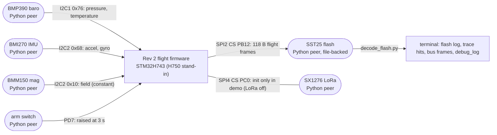

> **Simulation showcase (work in progress, fork only):** see [sim/README.md](sim/README.md).

<h1>Flight Computer Firmware</h1>

<!-- simantic-banner -->
> **Run this firmware with no hardware.** [Simantic](https://simantic.com) simulates the whole board, peripherals, sensors and buses included. Try it free at **[simantic.com](https://simantic.com)**, or run it locally: `curl -fsSL https://simantic.com/install | sh`


<p>Description: The flight computer is Sun Devil Rocketry's first ever in-house designed and manufactured high-power rocketry altimeter. The flight computer project aims to serve as a drop-in replacement for the commercially produced altimeters currently used in Sun Devil Rocketry rockets, while also supporting more advanced rocketry projects by including extra sensors and peripheral interfaces. The board supports dual-deployment parachute ejection through the use of ematch screw terminals, a barometric pressure sensor, a buzzer, an ARM Cortex-M7 microcontroller, and 4 Mb of external flash for logging flight data. The computer also includes a USB port and a micro SD card for easy access to flight data, so a seperate data collection kit is not required. To support more advanced projects, the computer contains a LoRa wireless module, a GPS module, a 9-axis IMU, and four 3-connector PWM servo drivers. Design of the flight computer was optimized for a minimum form factor to allow the computer to be used in a variety of differently sized rockets. </p>

<h2>Working Directory Structure</h2>

<p>
app: application code for the flight computer containing source directories

auto: auto-generated code from STM32CubeMX (not compiled into application)

driver: hardware modules containing hardware specific code for SDR boards

init: Microcontroller initialization and configuration code

lib: third-party libraries for device drivers and middleware, microcontroller pin and peripheral configurations 

mod: general purpose shared library for SDR's embedded team

test: automated tests
</p>

# Projects:
### PCB: A0002-Rev2 | Flight Computer Rev. 2
#### MCU: STM32H750VBT6
#### MPU Architecture: ARM Cortex-M7
#### Source code: app/rev2

The current generation SDR flight computer. Supports telemetry and data logging with the ability to support more advanced projects.

### PCB: A0010 | Flight Computer Rev. 3

#### MCU: STM32H733VGT6

#### MPU Architecture: ARM Cortex-M7

#### Source code: app/rev3 

The next generation SDR flight computer, which is in early development.

## Demo


The team's Rev 2 flight firmware (`app/rev2`) runs on a simulated STM32H743 (stand-in for the H750) with Python peers for
the sensors, and `./demo` streams every log channel the firmware has, with the original text and virtual timestamps:

- **Flight log in flash**: the 118-byte frames the firmware writes to its SST25 flash, decoded as they appear (`(flash log)` lines: state, barometric altitude, pressure, speed, acceleration).
- **Sim trace hits** on `flash_init`, `imu_init`, `telemetry_init`, `fc_state_update` (r0 is the new state: 1 IDLE, 2 CALIB, 3 LAUNCH_DETECT, 4 ASCENT, 6 APOGEE, 7 DESCENT) and `error_fail_fast` (never hit), verbatim.
- **I2C bus frames** from `--frames` (the first few, verbatim), and the peers' own prints (`[imu] ...`).
- **The firmware's `debug_log` messages** (`[INFO]: State Change: 3->4`, calibration messages). Rev 2 has no console: `debug_writer` in `main.c` is a stub that drops them, so nothing is transmitted on silicon or in the sim. `./demo` recovers the text from the byte writes into `debug_handle` (`--trace-memory`) and lists it at the end of the run, because the sim only writes those records when the run ends.

There is no UART, ITM or RTT output on this firmware. Every sensor value is a **stand-in**: the peers replay
`emulator/resources/locked_in_flight.csv` open loop (nothing reacts to the firmware), and LoRa telemetry is switched off
(`SDR_LORA=0`) because the flight loop stalls with it on. The states, altitude, speed and frame logging are the firmware's
own computation. The firmware leaves ASCENT for APOGEE at log time 3.9 s while the replayed altitude is still climbing;
that is unexplained (see `sim/README.md`).



Run it (needs `sim` on PATH, `curl -fsSL https://simantic.com/install | sh`, and the Arm GNU toolchain):

```
git submodule update --init --recursive --depth 1
sh sim/build.sh
./demo        # about 1-2 min wall for 15 virtual s
```

