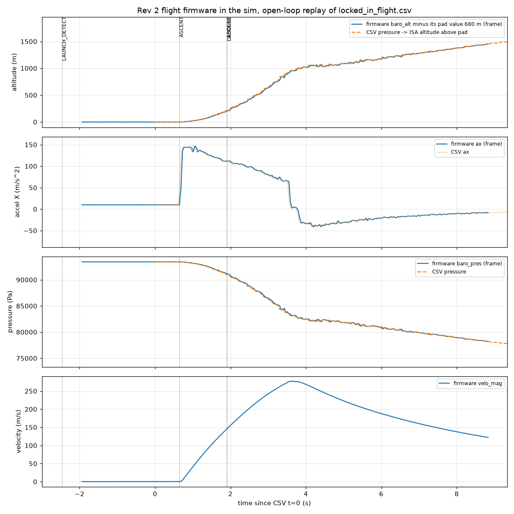
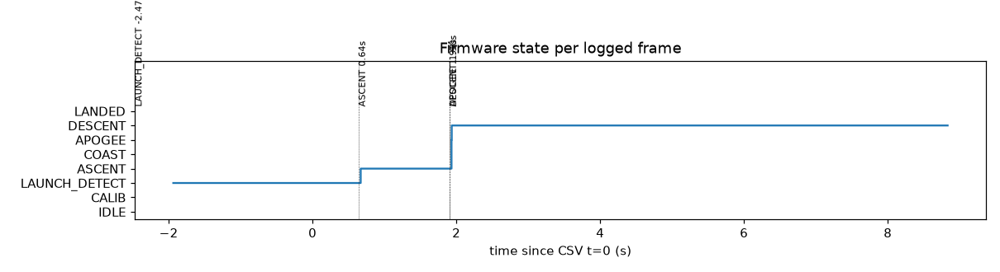
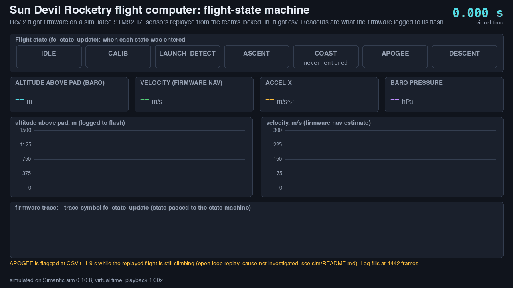
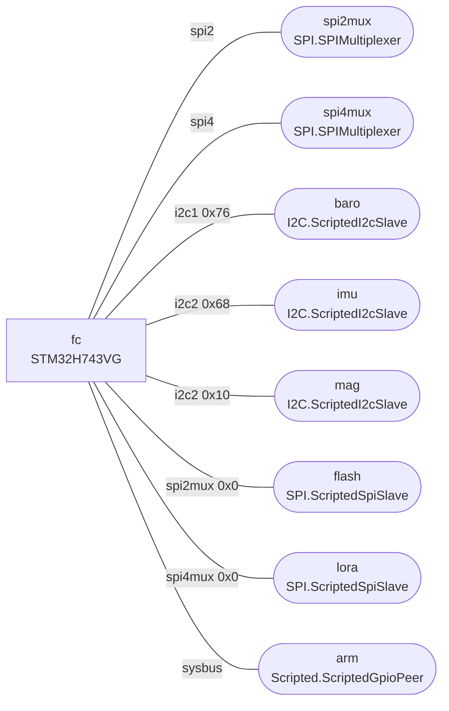

# Simulating the Rev 2 flight computer (work in progress)

Fork-only showcase: the team's own Rev 2 flight firmware (`app/rev2`, A0002-Rev2) built unmodified except for one
labelled sim-only patch, run on the simantic `sim` with Python peers standing in for the sensors.
Upstream is SunDevilRocketry/Flight-Computer-Firmware; nothing here is sent upstream.

**Status: flies, with one labelled fallback.** The firmware boots (IDLE 0.92 s virtual), arms at 3 s, calibrates,
enters LAUNCH_DETECT, and with LoRa telemetry off (`SDR_LORA=0`, see "LoRa stall") runs its flight loop at about
420 Hz through ASCENT, APOGEE and DESCENT while replaying the team's `locked_in_flight.csv` open loop. The logged
flight is only the first 8.9 s of the CSV, because the 512 KB flash fills (4442 frames of 118 B). With LoRa on the
flight loop stalls after 4.06 s (cause below). Nothing here is a claim about silicon.

*Re-run on `sim` 0.10.8 (build 64f89c38), 2026-11-25, LoRa off, `SDR_LAUNCH_S=6`, `--timeout 16`: 16 s of virtual time in 32 s of wall time (about 2 s per virtual second, loaded laptop). The state trace is the same as in the table below to the millisecond (IDLE 0.925 s, CALIB 3.000 s, LAUNCH_DETECT 3.530 s, ASCENT 6.638 s, APOGEE 7.901 s, DESCENT 7.903 s) and the flash filled with 4442 frames. The animation is a flight-computer dashboard: the flight-state chain with the virtual time each state was entered (from `--trace-symbol fc_state_update`), and altitude, velocity, acceleration and pressure as the firmware logged them to the simulated flash (`decode_flash.py`), drawn by `sim/make_gif.py out/frames.csv out/trace.log results/flight.gif 0.10.8`. Simulated on Simantic sim 0.10.8, virtual time, playback 1.00x. COAST is never entered in this run, and APOGEE is flagged at CSV t = 1.9 s while the replayed flight is still climbing (see below). The stimulus is the CSV replayed open loop, so this checks the firmware's own state machine and logging, not a real flight.*

`results/flight_full.png` adds the whole 188 s CSV truth beside the logged window.

## What runs

| Part | Peer | Bus | Status |
| --- | --- | --- | --- |
| BMP390 baro | `peers/bmp390_peer.py` | I2C1 0x76 | answers; pressure and temperature from the CSV, firmware compensation inverted numerically |
| BMI270 IMU | `peers/bmi270_peer.py` | I2C2 0x68 | answers; accepts the config upload, serves accel/gyro from the CSV |
| BMM150 mag | `peers/bmm150_peer.py` | I2C2 0x10 | answers; constant raw field and trims |
| SST25 4 Mbit flash | `peers/sst25_peer.py` | SPI2 CS PB12 | answers; file-backed (`out/flash.bin`) |
| RFM95 / SX1276 LoRa | `peers/sx1276_peer.py` | SPI4 CS PC0 | answers ID 0x12 and register writes; `lora_init` completes OK |
| Arm switch | `peers/arm_switch_peer.py` | PD7 | low at boot, raised at 3 s |

`flightdata.py` replays `emulator/resources/locked_in_flight.csv` (team emulator submodule, BSD-3) open loop.
Whether that CSV is a recorded flight is `unverified`.

Run: `sh sim/build.sh`, then
`cd sim && SDR_LAUNCH_S=6 SDR_LORA=0 sim run --scenario scenario.yaml --timeout 196 --trace-symbol fc_state_update`
(about 98 s wall on an idle machine), then `python3 decode_flash.py out/flash.bin > out/frames.csv` and
`python plot_flight.py out/frames.csv <the --trace-symbol log> results` (needs matplotlib; the GIF needs only pillow and ffmpeg).
`decode_flash.py` reads the 118-byte frames (layout from `flash_appa.c`; 4442 frames decoded, the values match the CSV).

## Measured (sim 0.10.1, this scenario)

| Observation | Value |
| --- | --- |
| Boot to IDLE (`fc_state_update` r0=1) | 0.925 s virtual (was 9.6 s with a blank flash) |
| CALIB (r0=2), armed at 3 s | 3.000 s virtual |
| 50 calibration samples (`sensor_dump`) | 3.41 s to 4.06 s virtual |
| LAUNCH_DETECT (r0=3) | 3.563 s virtual, `telemetry_init` returns OK |
| `sensor_dump` calls after 4.06 s, LoRa on | none to 7 s: starved by the SPI4 interrupt chain (below) |
| LoRa off, `SDR_LAUNCH_S=6`: `sensor_dump` / `nav_update` | 2512 each in the first 10 s (about 420 Hz) |
| LoRa off: ASCENT (r0=4) | 6.638 s = CSV t 0.638 s |
| LoRa off: APOGEE (r0=6) then DESCENT (r0=7) | 7.9015 s / 7.9029 s = CSV t 1.90 s (not the CSV's 18 s apogee, see below) |
| COAST (r0=5) | never entered |
| Flash log | full at 4442 frames (524,288 B), last frame CSV t 8.9 s |
| Firmware vs CSV, visual | baro_alt, baro_pres and ax overlay the CSV truth over the whole logged window (`results/flight.png`); no numeric error computed (`unverified`) |
| Wall time, 196 s virtual | 97.7 s |
| GPIO edges (`--trace-out`, 44 s virtual) | 178 MB of JSONL, mostly SPI2 pads: too big to keep, not committed |
| Image | text 82136 B, data 8700 B, bss 6340 B |

## Root causes found

- **0x3d (`telemetry_init` LoRa assert) was not a peer fault.** `lora_configure` returned `LORA_USING_DEFAULTS`
  (8) because the preset in RAM was all 0xFF. `lora_init` itself returns OK on every status (all HAL calls OK,
  peer sees the expected register sequence). The preset was lost in the SST25 peer: AAI word-program
  continuation frames carry no address but the peer reset its address to 0 after every frame, so the whole
  preset (and later flight frames) were programmed at address 0. Fixed in `peers/sst25_peer.py`.
- **551k SPI2 transactions** were `read_preset` scanning the whole blank 512 KB flash in 98-byte reads looking
  for a save bit. The flash now starts with a preset block (MODELED SIMPLIFICATION: stands for what the team's
  configuration tool writes; `set_default_configs` values plus WIRELESS_TRANSMISSION and a valid LoRa preset).

## MODELED SIMPLIFICATIONS

- **STM32H743VG stand-in.** `sim models` has no STM32H750. H750 and H743 are the same die family; the H750 has
  less flash. Flash size, memory map and clock tree of the stand-in against the H750 are `unverified`; the image
  (82 KB) fits either. HSE is 24 MHz, the firmware's own `HSE_VALUE`.
- **Open-loop replay.** The rocket does not react to the firmware. The CSV has only ~0.7 s of pad rows, so they
  are cycled until CSV time 0 plays at sim time 8 s.
- **Peers** are register files, not the silicon: instant flash program/erase, always-ready data, chosen BMP390
  NVM coefficients, constant magnetometer field, LoRa airtime from the programmed registers but no RF, no noise.

## Sim-only build patch (`lora-pll2.patch`) and the PLL2 question

The SPI4 (LoRa) branch of `HAL_SPI_MspInit` calls `HAL_RCCEx_PeriphCLKConfig` with a zero-initialised `PLL2`
struct (M = 0, N = 0). With `Spi45ClockSelection = PLL2` the HAL takes `RCCEx_PLL2_Config(..., DIVIDER_Q_UPDATE)`:
it disables PLL2 (the SPI2 branch had configured it), writes DIVM2 = 0, enables PLL2 and polls PLL2RDY for 2 ms,
returning HAL_TIMEOUT, so `error_fail_fast(ERROR_LORA_SPI_INIT_ERROR)` (0x3c) at 4.08 ms.

Evidence: RM0433 (RCC_PLLCKSELR) says DIVM2 = 0 is "prescaler disabled" and that 0 is to be used when PLL2 is
not used; the pyrite H7 RCC model (`stm32h7_rcc.rs`) implements exactly that: PLLxRDY needs PLLxON, a ready
reference and DIVMx != 0, and its PLL lock timings are from H753 bench measurements. The model follows the manual;
the sim differs from silicon only if silicon sets PLL2RDY with DIVM2 = 0, which neither the RM nor the model's
bench data supports. Verdict: a firmware configuration defect (the struct was meant to carry the SPI2 values),
expected to fail the same way on silicon. Not measured on silicon (`unverified`; no H750 rig here). The
reconfiguration would also drop the SPI2 flash clock. The patch gives the SPI4 branch the SPI2 branch's PLL2
values and is applied for the build only by `build.sh`.

## Firmware fact: dual deploy cannot fire

`check_config_validity` in `prelaunch.c` rejects `DUAL_DEPLOY_ENABLED` and active roll / pitch-yaw control, and
arming with dual deploy calls `error_fail_fast(ERROR_CONFIG_VALIDITY_ERROR)`. So `flight_deploy` never lights an
igniter in this firmware version and APOGEE to DESCENT is the only deploy marker. This is a property of the
firmware, not of the sim.

## LoRa stall (the flight loop after 4.06 s)

Evidence, all from `--trace-symbol` / `--trace-interrupts` / `--trace-memory`:

1. After the last calibration `sensor_dump` (4.0637 s) the main loop reaches `lora_fsm_update(SYNCHRONOUS)` once,
   then `flash_is_flash_busy` -> `flash_get_status` -> `HAL_SPI_Transmit` on SPI2 (10 ms HAL timeout) and never returns.
2. From 4.0638 s SPI4 (IRQ84, priority 2) runs back to back: 779,191 entries to 7 s, zero idle gaps in a 5.5 ms
   window. SysTick (priority 15) stops (4063 ticks in 7 s), so the HAL timeout in (1) never expires.
3. The interrupt chain is the firmware's async LoRa TX FSM (`lora_async.c`). In `LORA_TX_STATE_TRANSMITTING` it reads
   `OPERATION_MODE` over SPI4 from the read-complete callback until it sees STANDBY, with no delay. The driver has no
   DIO0 EXTI (`HAL_NVIC_EnableIRQ( [lora placeholder] )` in `sensor.c`), so there is no TxDone pin for a peer to drive.
4. Peer fault, fixed: the old SX1276 peer never left TX mode, so the poll never ended. `sx1276_peer.py` now computes
   airtime from the registers the firmware programmed (SF, BW, CR, preamble, payload, CRC/header bits; datasheet
   formula; 92.4 ms for the firmware's 48-byte packets) and returns to STANDBY with TxDone set. The FSM then chains
   one packet after another (TX start/done every 92.5 ms from 4.064 s), still entirely in interrupt context: the loop
   stays starved.
5. Per-read interrupt cost: about 4 SPI4 interrupts of about 3.8 us each per 15 us read, i.e. the CPU is saturated.
   Whether silicon leaves the main loop idle time here depends on the real cost of `HAL_SPI_IRQHandler` and the FSM
   callback (cache, flash wait states) against the real SPI4 byte time; neither was measured (`unverified`). About one
   SPI4 entry in four finds no enabled flag set (SR = TXP|TXTF with only DXP/EOT enabled): either NVIC re-pend
   semantics in the sim or the model holding the line a moment longer than silicon would; not resolved
   (`unverified`). A model gap is a candidate, not proven.

**Labelled fallback (`SDR_LORA=0`):** `sst25_peer.py` leaves WIRELESS_TRANSMISSION (enabled_features bit 4) out of the
preset block, so `lora_fsm_update` is never called. This is a MODELED SIMPLIFICATION that removes LoRa telemetry from
the flight; it hides the stall, it does not fix it. Default (`SDR_LORA=1`) keeps LoRa on and stalls.

## Other findings

- The CSV's first ~0.7 s of "pad" rows included the boost start (ax 45 m/s^2 at 0.653 s); cycling them tripped
  LAUNCH_DETECT -> ASCENT at 4.5 s. `PAD_END_S` is now 0.6 s. `SDR_LAUNCH_S` is 6 (LAUNCH_DETECT is entered at 3.53 s;
  the old note said 12).
- The firmware leaves ASCENT for APOGEE at CSV t 1.90 s (`nav_pof` = NAV_DESCENT) while the replayed pressure is still
  falling and its own `velo_mag` is about 150 m/s; the CSV's real apogee is about 18 s. Cause not investigated
  (`unverified`); candidates are the nav filter on the replayed data or an axis-convention mismatch of the CSV.
- Frame time `t_ms` counts from `launch_detect_start_time`, set at the last calibration sample (sim 4.064 s), not at
  LAUNCH_DETECT entry (3.53 s). `plot_flight.py` aligns on 4.064 s (`SDR_FRAME0_S`); the overlay confirms it.
- The CSV is open loop (MODELED SIMPLIFICATION): no plant reacts to the firmware, and whether it is a recorded flight
  is `unverified`. Dual deploy cannot fire in this firmware version (above).

## Open

- Decide model-vs-firmware for the SPI4 interrupt saturation (item 5): needs retired instructions per interrupt on
  this ELF against the silicon cycle table, and the spurious-entry check.
- The 512 KB flash holds 8.9 s of the CSV at the firmware's logging rate; the rest of the 188 s is only in the stimulus.
- Why APOGEE at 1.9 s.

## Licence

The firmware is BSD-3-Clause, Copyright 2025 Sun Devil Rocketry (see `LICENSE`, `NOTICE`: ST HAL BSD-3, CMSIS
Apache-2.0, ST USB SLA0044). Files under `sim/` are offered under the same BSD-3-Clause terms.
